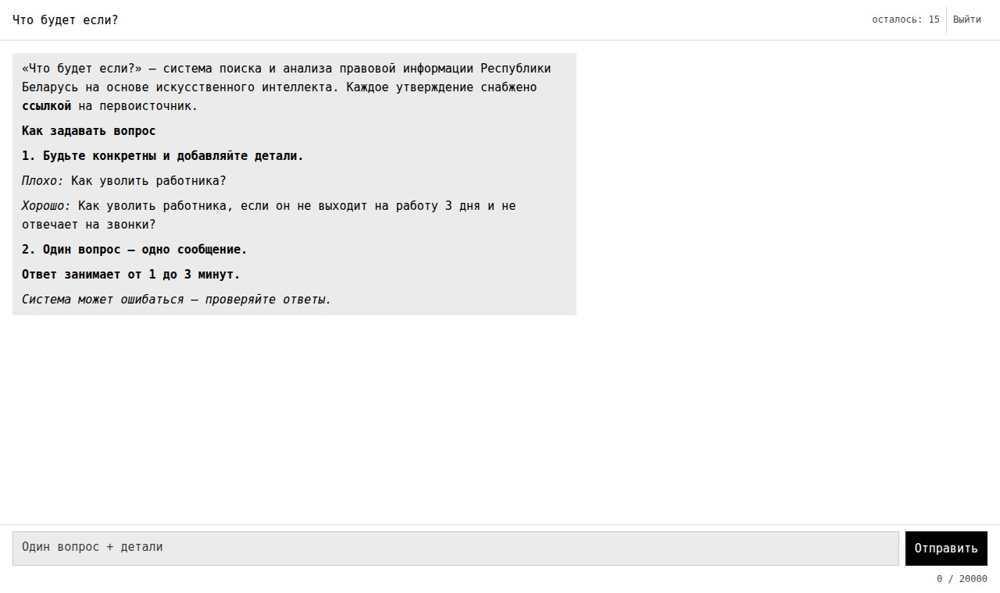
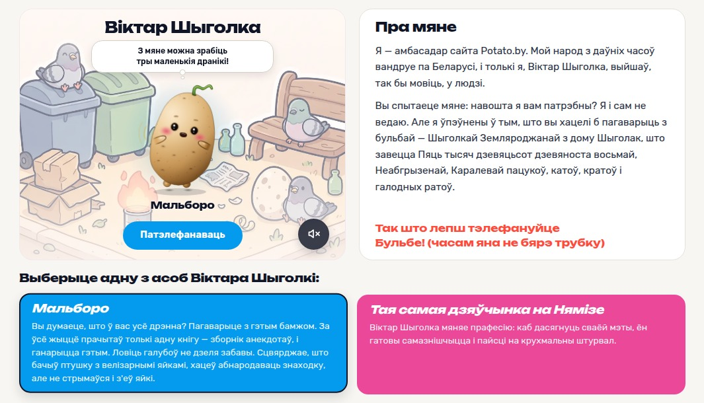
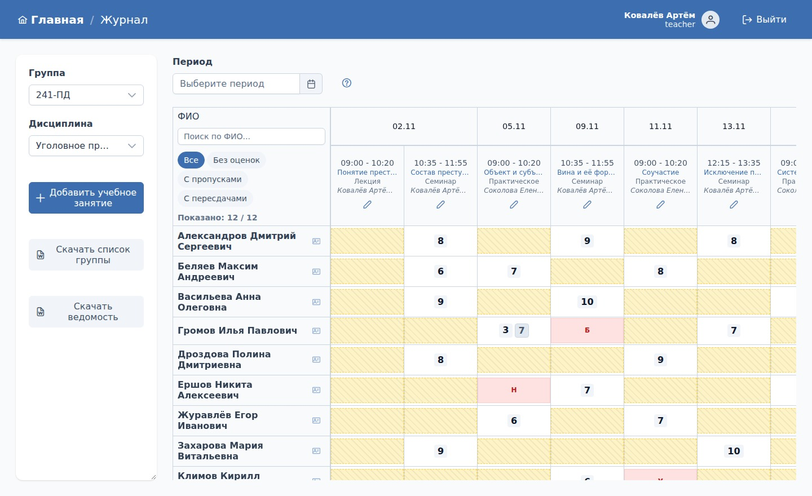

# Artyom Borodin

[Email](mailto:artyom-borodin@proton.me)

---

## About Me

Currently a student at the Academy of the Ministry of Internal Affairs of the Republic of Belarus while working in the IT department of a metropolitan university. I build tools that make legal and administrative work faster and more accurate.

---

## Technologies

* **Frontend & Backend:** JavaScript & TypeScript (Node.js), Vue, Express, Turso, SQL, Google Cloud Platform, Qdrant, Gemini Enterprise Agent Platform, OpenRouter.
* **Also worked with:** Java, Android SDK, Firebase

---

## Projects

### [What If (formerly borodinbaa)](https://whatif.by/)
* **Status:** MVP

A RAG-based AI legal assistant. Included in the state catalog of innovative developments of BelISA (2025). Exhibited at the "Great Stone" Industrial Park.

### [AMIA Schedule](https://schedule.amia.by)
* **Status:** Officially Implemented

Web service for the schedule of the Academy of the Ministry of Internal Affairs of the Republic of Belarus. Used daily by hundreds of users.

### [Biblio-formatter](https://github.com/artyom-borodin/biblio-formatter)
* **Status:** MVP

AI bibliography formatter based on the standards of the Higher Attestation Commission of the Republic of Belarus.

### [Photo Table Generator](https://github.com/artyom-borodin/photo-table-generator)
* **Status:** MVP

Automated generation of photo tables for investigative action protocols. Developed for the Investigative Committee of the Republic of Belarus.

### [AMIA Journal](https://github.com/artyom-borodin/amia-journal)
* **Status:** In Development

Frontend for an attendance and grade tracking service for the Academy of the Ministry of Internal Affairs of the Republic of Belarus. 

---

## Achievements

* **Speaker — Project Presentation**  
  Presented the "Borodinbaa" (What If) at the Great Stone China-Belarus Industrial Park.
  
* **1st Place — "The Hackathon: AI Era"**  
  Best AI-based solution, Minsk.
  
* **1st Place — Personal Data Protection Competition**  
  Best research paper, National Center for Personal Data Protection.
  
* **2nd Place — IT-Challenge**  
  Republican Olympiad in Information Technology, Polotsk.
  
* **Winner of the "Lawmaking" Category**  
  Belarusian Student Law Olympiad, Belarusian State University.
  
* **Participant — IT-Challenge 2026**  
  Republican Olympiad in Information Technology among higher education students.
  
* **Ministerial Stage Finalist — "100 Ideas for Belarus"**  
  Presentation of the "Borodinbaa" (What If) at the national level, Minsk.
  
* **Participant — InDev Solutions Hackathon (BSU & HTP)**  
  Case: "Smart Hotel Access System".
  
* **Participant — X International Olympiad in Informatics among Cadets**  
  National stage, BSUIR.
  
* **Finalist of the Russian MIA Hackathon**  
  Big Data & AI in Law Enforcement track, Moscow.
